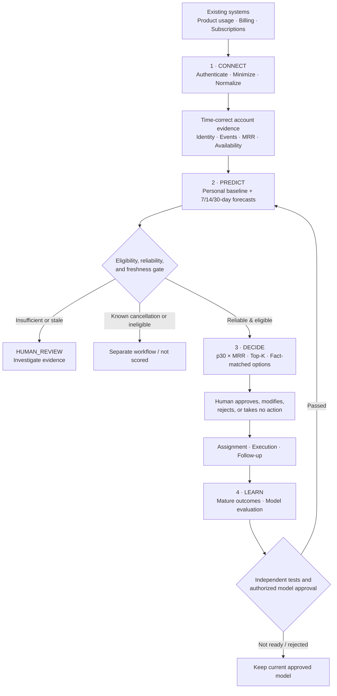

<div align="center">

# 🍍 LaiCai
### Predict early. Plan realistically. Let humans decide.

**From customer churn warnings to explainable, actionable retention decisions.**

**Dormathon 2026 · Track 1 — Predictive Model: Predict Early, Decide Better**

**Connect → Predict → Decide → Learn**

[The Problem](#the-problem) · [Our Solution](#the-solution) · [Key Features](#key-features) · [Product Walkthrough](#product-walkthrough) · [Getting Started](#getting-started) · [Evaluation](#evaluation-and-evidence) · [Demo](#demo-guide)

</div>

> **What is LaiCai?** LaiCai (RetainIQ v2) is a human-governed customer retention intelligence system for subscription businesses. It is designed to connect to existing product, billing, and subscription systems; identify emerging churn risk across **7, 14, and 30 days**; prioritize limited Customer Success resources; recommend fact-supported actions; and learn responsibly from subsequent outcomes.
>
> **Demo and evidence note:** The current `main` branch includes a functional local data foundation and an interactive five-page **synthetic frontend demo**. Some prediction, decision, feedback, and live-service integrations described below are **product requirements / target architecture**, not independently verified production features on `main`. No real-world model-performance, retention-uplift, or saved-revenue result is claimed. See [Implementation & evidence status](#implementation-and-evidence-status).

---

## At a glance

| Question | LaiCai's answer |
|---|---|
| **Who is it for?** | Customer Success (CS) teams, retention managers, subscription-business leaders, and data/ML operators. |
| **What problem does it solve?** | Churn warning signs exist, but teams often lack the time, trustworthy predictions, financial context, and workflows to act on them. |
| **What does it predict?** | Cumulative risk that an **active paying subscription account** will churn within 7, 14, or 30 days, provided sufficient trustworthy evidence exists. |
| **What makes it different?** | Account-specific behavioral baselines, multi-horizon forecasts, reliability-aware routing, MRR-weighted human review, explainable options, and later outcome checks. |
| **Who makes the final decision?** | **A person.** LaiCai never autonomously sends discretionary outreach, grants discounts, or changes subscriptions. |
| **How does a company use it?** | As an **extension to its existing systems**, through mapped historical imports and an authenticated event Push API; no replacement of the company's SaaS app or CRM is necessary. |

## The problem

### Churn is expensive. Acting before churn is even harder.

Subscription businesses accumulate signs of disengagement—declining product usage, an unusual break in activity, failed payments, or changes to subscription behavior. By the time a cancellation is finalized, however, the best opportunity for early intervention may already be gone.

**This is a real-world retention challenge:**

- **52%** of consumers canceled at least one subscription in the preceding year, according to Recurly's **2026 State of Subscriptions** research, which discusses patterns across **2,200 subscription businesses and 76 million unique subscribers**. [Recurly — 2026 subscription research](https://recurly.com/blog/analyzing-trends-of-76-million-subscribers/).
- In an actual subscription-business case, **Unbounce reported that 20% of its cancellations were involuntary**, associated with billing errors or expired cards. Its managers could not manually follow up with every failed-payment account. [Recurly — Unbounce case study](https://recurly.com/resources/case-study/unbounce-churn/).

*These are third-party industry examples—not LaiCai's own model results or verified business impact. In particular, the Unbounce figure describes Unbounce's cancellations, not a universal industry rate.*

### What is missing from traditional churn dashboards?

| Common approach | Operational gap | What the team really needs |
|---|---|---|
| A static churn score | Doesn't establish **when** churn might happen | Separate 7-, 14-, and 30-day warning windows |
| One rule for everyone (e.g., “no login for 7 days”) | Ignores each account's normal usage rhythm | Customer-relative activity change |
| A “high-risk” label | Can hide stale, missing, or contradictory evidence | Reliability, freshness, and the option to **abstain** |
| A long list of risky accounts | Ignores available staff and account value | MRR-aware, capacity-limited priorities |
| Generic retention offers | May be unrelated to the actual issue | Suggestions tied to observed supporting facts |
| A report saying “customer retained” | Cannot prove an action caused the outcome | Auditable decisions, mature outcomes, and honest evaluation |

**The central problem is the prediction-to-decision gap:** even a good prediction has limited value unless the right person can understand it, prioritize it, act responsibly, and later evaluate what happened.

### Target users and the decisions they make

- **Customer Success Manager:** Which accounts need a check-in today, and what evidence should I review before contacting them?
- **Retention / CS Lead:** Given a limited number of review slots and a finite budget, whom should we investigate or prioritize first?
- **Business / Operations Manager:** Which revenue exposures and outstanding cases deserve attention, and how much could an action reasonably cost?
- **Data / ML Operator:** Which sources, prediction cohorts, and models remain trustworthy enough for use?

## The solution

LaiCai connects four stages in one operational loop: **Connect → Predict → Decide → Learn**.



**The distinction:** a forecast supports a retention decision; it does **not** predict how effective an offer will be or authorize the offer automatically.

## Key features

### 1. Connect — trustworthy data before prediction

**Question answered:** *Can we trust the customer facts we're using?*

Companies bring existing account data through a **historical CSV import** or the **authenticated event Push API**. LaiCai's data-foundation contract supports:

1. **Source authorization and minimization:** Validate approved event types and attributes; reject unnecessary restricted data before storage.
2. **Explicit account mapping:** Link source-specific identifiers to one paying subscription account; do not silently match customers using email.
3. **Canonical event history:** Normalize usage, billing, and subscription changes with source IDs, timestamps, and versioned mappings.
4. **Idempotent ingestion:** Duplicate event IDs do not duplicate account activity or financial records.
5. **Point-in-time correctness:** A feature is usable at time `as_of` only when its **event time and original availability time** are both at or before that cutoff.
6. **Data health:** Make freshness, mapping errors, unavailable coverage, and rejected events visible to authorized operators.
7. **Tenant isolation:** Keep each company's data inside its authenticated tenant/source/purpose scope.

**Why this matters:** A model evaluating a customer on 1 September must not see a cancellation or corrected invoice that only became known on 15 September.

**Churn is defined carefully:** an actual end of paid entitlement qualifies; a failed payment alone does not. Known pending cancellations follow a separate recovery process rather than masquerading as an early prediction. Where multiple subscriptions exist, the current account-level policy uses loss of the **last active paid subscription**.

### 2. Predict Early — personalized multi-horizon churn foresight

**Question answered:** *Who is at risk, how soon, what changed, and is the warning reliable?*

The Prediction Engine design uses **three separate 7-, 14-, and 30-day classifiers** with time-safe customer features and calibrated cumulative probabilities:

```text
P(churn by day 7) ≤ P(churn by day 14) ≤ P(churn by day 30)
```

The primary modeling candidate is **LightGBM**, fairly compared against a **rule-based baseline** and **logistic regression**. A selected model must earn its place through held-out evaluation; “LightGBM” is not itself evidence of accuracy.

#### The personalized baseline advantage

Imagine two subscriptions:

| Account | Normal behavior | Recent behavior | Interpretation |
|---|---|---|---|
| **A** | Logs in once each week | Still logs in once a week | This can be completely normal for A. |
| **B** | Uses the product every day | Suddenly stops using it | This is a meaningful deviation for B. |

A simple “low weekly logins” rule may confuse A and miss the **change in B**. LaiCai's feature design compares recent activity with each account's **own prior non-overlapping history**, alongside billing and subscription signals. New or sparse accounts use explicit missingness/reliability handling, rather than pretending their personal baseline exists.

#### More than a percentage

| Output | Meaning |
|---|---|
| **7-day probability** | Near-term urgency and early attention |
| **14-day probability** | Intermediate planning window |
| **30-day probability** | Main horizon for financial exposure and prioritization |
| **Behavior change** | Recent usage relative to an earlier personal baseline |
| **Explainability** | Horizon-specific fitted-model attributions (e.g., SHAP), explained with actual feature values |
| **Reliability** | `sufficient_evidence`, `limited_evidence`, or `insufficient_evidence` |
| **Freshness** | `fresh`, `partially_stale`, `stale`, or `unknown` |
| **Abstention** | Return no numerical forecast when critical evidence is insufficient |
| **Prediction history** | Dated, versioned snapshots rather than an invented future risk trajectory |

**Daily evaluation includes silent accounts.** A customer who has stopped generating events must not disappear from monitoring merely because no new event triggered a score.

**Explainability is not causality:** a payment-history or usage feature associated with high risk does not prove that changing it will prevent churn.

### 3. Decide — a workable retention plan, not just a warning

**Question answered:** *Who should we help first, and what can our team realistically do?*

The Decision Engine routes eligible accounts using data reliability and policy **before** any financial ranking:

| Route / state | Meaning | Next step |
|---|---|---|
| `PRIORITY_REVIEW` | Eligible, sufficiently supported, policy-qualified account | Compete for the limited review shortlist |
| `HUMAN_REVIEW` | Stale, incomplete, conflicting, or otherwise limited evidence | Investigate data/account facts first |
| `OBSERVE` | Reliable account below review threshold or in an applicable discretionary-contact cooldown | Continue monitoring |
| `KNOWN_CANCELLATION` | Cancellation request already known | Separate cancellation-recovery workflow |
| `NOT_ELIGIBLE` | Outside active paying-account population | No prospective churn score |

The core review-priority proxy is:

```text
30-day MRR-weighted churn exposure = calibrated P(churn within 30d) × as-of MRR
```

This helps managers distinguish high *percentage risk* from high *monthly recurring revenue exposure*. It is **not** precise cash loss, customer lifetime value, or provably recoverable revenue.

**Review planning:** select up to `K` eligible accounts for a defined set of human review slots, ranked by this exposure within the **same currency**. Use `p7` as an urgency tie-break, respect cooldowns, and account for human data-investigation workload. `K` means **review capacity, not customers saved**.

#### Fact-supported action options

| Observed evidence | Candidate action | Safeguard |
|---|---|---|
| Verified usage drop against a valid baseline | `ACCOUNT_CHECK_IN` | Ask what changed; don't assert why |
| Confirmed failed / past-due payment | `PAYMENT_RECOVERY` | Follow actual billing policy |
| Feature-level usage/onboarding gap | `PRODUCT_WALKTHROUGH` | Available only if that evidence exists |
| Missing identity, stale source, insufficient facts | `DATA_INVESTIGATION` | No speculative sales offer |
| No justified discretionary intervention | `NO_INTERVENTION` | Record reason and monitoring plan |

Support escalation, plan changes, downgrades, pauses, and discounts require additional actual support/entitlement/pricing evidence and authorization; they remain **disabled or simulation-only** without it.

LaiCai is designed to preserve the **original proposal**, **human final choice**, **reason**, **owner**, **approval time**, **execution**, and **later observations**. A manager may **approve, modify, reject, or choose no intervention**. The backend must enforce monetary/staff limits transactionally before any production approval; an in-browser demo guard is not a replacement for this.

#### What-if ROI — understand break-even before spending

A manager can ask: *“Is spending RM150 on this account potentially worth it?”*

The one-month break-even calculator makes its assumptions explicit:

```text
One-month contribution value = MRR × contribution margin
Break-even absolute churn-risk reduction = action cost / contribution value
Required share of existing churn risk = break-even reduction / p30
Scenario net value = assumed absolute risk reduction × contribution value − cost
Scenario ROI = scenario net value / cost
```

**Illustrative scenario only — not measured action effectiveness:**

| Input / result | Value |
|---|---:|
| Monthly recurring revenue | RM1,200 |
| 30-day churn probability | 65% |
| Assumed contribution margin | 70% |
| Proposed action cost | RM150 |
| One-month contribution value | RM840 |
| **Absolute reduction required to break even** | **17.86 percentage points** |
| **Share of existing 65% risk that must be removed** | **27.47%** |
| If *hypothetically* the absolute reduction were 10 pp | Scenario net **−RM66**, ROI **−44%** |

The calculator answers **what would need to happen**, not **what will happen**. It is explicitly `SCENARIO_ONLY` and cannot establish real causal uplift or actual saved revenue.

### 4. Learn — close the loop without losing human control

**Question answered:** *What actually happened, and should the model be changed?*

LaiCai's learning design connects each **immutable prediction** to later, source-backed subscription outcomes:

1. Wait until the relevant **7-, 14-, or 30-day** observation window has passed.
2. Record `PENDING`, `MATURE_POSITIVE`, `MATURE_NEGATIVE`, `INCOMPLETE`, or `INELIGIBLE` as appropriate.
3. Do **not** treat an unobserved account or immature window as a successful retention outcome.
4. Evaluate predictions on properly observed cohorts, preserving prediction and label versions, sample sizes, and intervention exposure.
5. Retrain a **candidate** only with valid mature information; compare it against the incumbent on independent later evidence.
6. Promote a model only after predefined quality gates and **authorized human approval**; otherwise keep the incumbent and preserve rollback capability.

**Two different clocks matter:**
- A prediction's outcome window starts at its original `as_of`.
- An action's operational follow-up may start when the action was executed.

**A customer who remained subscribed after a check-in is an observed outcome—not proof that the check-in saved them.** Determining actual incremental retention impact requires a suitable controlled comparison.

## Product walkthrough

The product has **five primary dashboard areas**, reflecting the questions an operating team asks:

| Page | Route on the current frontend | What users can inspect / do |
|---|---|---|
| **Business Overview** | `/command-center` | Monitored accounts, risk coverage, revenue exposure by currency, review workload, overdue work, integration warnings, and navigation into evidence. |
| **Data Integration** | `/integrations` | Source connection status, sync/freshness, accepted and rejected events, coverage, safe error detail, and source health. |
| **Churn Prediction** | `/predictions` | Account risk by 7/14/30-day horizon, reliability, freshness, route, owner, filters, and prediction detail. |
| **Retention Actions** | `/cases` | Priority/Human Review/Observe queues, reviewer capacity, evidence-backed action suggestions, human decisions, execution status, and break-even scenarios. |
| **Customer Insights** | `/customers/:customerId/timeline` | Trace account events → prediction → decision → execution → observed result and feedback readiness. |

Secondary prediction and case detail routes open focused records: `/predictions/:predictionId` and `/cases/:caseId`.

**The intended user journey:** a manager notices unusual exposure in **Business Overview**, checks the risk and explanation in **Churn Prediction**, verifies supporting sources in **Data Integration**, chooses an eligible option through **Retention Actions**, and later uses **Customer Insights** to understand the actual history.

### Example: one account through the loop

*Hypothetical account journey; the sequence and numbers below illustrate behavior, not actual customer data or measured model output.*

1. **Connect:** Account B has dated subscription, usage, and billing activity mapped into one tenant-scoped history.
2. **Predict:** B's normally daily activity drops sharply. The model creates an immutable 7/14/30-day forecast based only on available evidence and marks its reliability.
3. **Decide:** An eligible, reliable risk case enters the shortlist. The manager checks B's MRR, source facts, required staff minutes, and a suitable check-in candidate.
4. **Human choice:** The manager approves, modifies, rejects, or takes no action. The original suggestion and decision are recorded separately.
5. **Learn:** After the observation period is mature, actual subscription status is linked to the earlier prediction. Evaluation can incorporate the outcome without claiming the check-in caused it.

## Business value and intended impact

LaiCai is built to improve **decisions under constraints**, rather than to promise that every flagged customer can be saved.

| Business outcome | Practical value | How to evaluate it credibly |
|---|---|---|
| **Better focus** | CS teams spend scarce attention on relevant, high-exposure cases | Recall@K, subsequently churned MRR identified@K, reviewer workload |
| **Earlier warning** | Teams can investigate material changes before a known cancellation | First-alert lead time at **matched** alert volume, missed churn, false alerts |
| **Smarter spending** | Cost, staff time, and break-even assumptions are visible before approval | Capacity compliance, eligible action rate, recorded actual costs |
| **Greater trust** | Incomplete/stale data trigger warnings or investigation rather than fake certainty | Abstention share, calibration, performance by data-quality cohort |
| **Accountability** | Teams can trace evidence, model, human choice, and outcome | Auditable timeline and feedback maturity/completeness |

### Commercial impact illustration — not a savings claim

Suppose a subscription business has **1,000 paying accounts**, **5% monthly churn**, and **RM200 average MRR**. If 50 accounts stop subscribing, their starting recurring revenue totals **RM10,000 MRR**. That illustrates the scale of exposure such a business might monitor—it does **not** show that LaiCai would recover RM10,000, prevent 50 cancellations, or produce a specific ROI.

**Our measurable hypothesis:** if the same number of CSM review slots surfaces more accounts that will subsequently churn—and does so with manageable false-alert volume and reliable evidence—the team can prioritize its work better. **Actual customers saved** is a different claim and requires valid intervention evidence.

## Technical architecture

### Logical design

```text
Existing company SaaS / billing / subscription systems
                 |
      CSV history or authenticated Push API
                 v
PART 1 · DATA FOUNDATION
  Tenant/source/purpose access · identity mapping
  Allowlist validation · minimal canonical events
  Dated subscription state · source availability · MRR
                 |
        time-correct snapshots + labels
                 v
PART 2 · PREDICTION ENGINE
  Historical personal baseline + billing signals
  7/14/30-day models · calibration · explainability
  Freshness/reliability/abstain · versioned forecasts
                 |
                 v
PART 3 · DECISION ENGINE
  Eligibility + quality routing · p30×MRR · Top-K
  Fact-based options · capacity/budget · scenario ROI
  HUMAN APPROVAL · execution/audit/follow-up
                 |
                 v
PART 4 · FEEDBACK AND DASHBOARD
  Mature label reconciliation · model evaluation
  Authorized candidate release/rollback · timelines
                 |
       Approved release returns to prediction
```

### Technologies and separation of concerns

| Layer | Technology / design | Important boundary |
|---|---|---|
| Frontend | **React 19 + TypeScript + Vite** | Five-page dashboard, reusable domain types/services and synthetic demonstration adapters |
| Local backend and data foundation | **Python standard library + WSGI + SQLite** | Authenticated ingestion, canonical records, import/replay, tenant/source-scoped reads |
| Planned/shared database architecture | **PostgreSQL / Supabase-compatible design** | Managed tenancy, persistence, and transactional server-side rules require deployed verification |
| Prediction approach | **LightGBM**, logistic regression and rule baselines; horizon calibration | Model artifacts and empirical metrics must be built and validated against eligible time-safe data |
| Decision policy | Deterministic routing, human shortlist, action catalogue and financial scenarios | The decision service must enforce role, money, capacity and concurrency constraints |
| Learning | Mature feedback, registry, independent candidate comparison | No automatic per-event self-updating production model |

**Canonical entities:** accounts, source identities, subscriptions and subscription events, billing events, usage events, feature snapshots, churn labels, predictions, decision cases, action proposals, human decisions, outcome observations, prediction feedback, evaluation runs, model registry, and retraining runs.

**Key conventions:** `tenant_id` from authenticated server context; one immutable `prediction_id` per account snapshot; `prediction_run_id` for the batch; UTC time; versioned policies/models/labels; integer money in minor units plus ISO currency.

### Repository map (current `main`)

```text
LaiCai/
├── src/                       # React/TypeScript frontend
│   ├── app/                   # Routing, app state, navigation
│   ├── features/              # The five dashboard pages + detail drawers
│   ├── components/            # Shared UI components
│   ├── domain/                # Typed customer, risk, case, scenario logic
│   ├── hooks/                 # Data and navigation hooks
│   └── services/              # Frontend data contracts/demo adapters
├── retaniq/                   # Python Part 1 ingestion and data foundation
│   └── synthetic/             # Synthetic SaaS dataset tools
├── migrations/                # Current local SQLite migrations
├── tests/                     # Python foundation/synthetic tests
├── examples/                  # Internal history/handoff examples
├── configs/                   # Synthetic configuration
├── docs/                      # Dataset, frontend, integration and handoff guides
├── DATASET_CARD.md            # Dataset provenance and real-data readiness
├── TEAM_LOG.md                # Per-commit evidence and handoff log
└── README.md
```

## Integrating LaiCai into an existing business

**LaiCai is an extension, not a replacement.** An organization keeps its existing product, subscription/billing service, and CRM. It connects selected, authorized customer history to LaiCai.

#### Step 1 — establish the account mapping

An authorized operator provisions a tenant, source integrations, a service principal or integration token, permitted purposes and explicit source-account mappings. Source IDs map to one canonical paying account; they are not inferred from contact email.

#### Step 2 — import history, then push incremental events

For historical data, use a versioned CSV mapping with trustworthy timestamps. For ongoing updates, the implemented data foundation exposes:

**`POST /v1/ingest/events`**

```http
POST /v1/ingest/events HTTP/1.1
Authorization: Bearer <INTEGRATION_TOKEN>
Content-Type: application/json

{
  "source": "product_app",
  "source_event_id": "evt_1029",
  "external_customer_id": "acct_001",
  "event_type": "session_started",
  "occurred_at": "2026-10-10T09:00:00Z",
  "attributes": { "feature": "analytics" },
  "schema_version": "1.0"
}
```

The **server derives tenant identity from authentication**, not the request body. The actual implementation rejects unallowlisted categories, unknown identities, invalid schema or timestamps, and duplicate event IDs reused with different payloads. A replay importer uses the same canonical normalization/identity rules.

#### Step 3 — verify freshness, source coverage, and account status

A service uses authorized integration-health or account-as-of queries to confirm what was available. The current Part 1 implementation includes `GET /v1/integrations` for a source-scoped integration and `GET /v1/admin/integrations` for separately authorized integration-health operators.

#### Step 4 — score and review

The **integrated product contract** takes eligible as-of features into prediction, produces the versioned 7/14/30-day forecast, and creates a policy-routed **human review case**. The company can retain its existing contact/support tools; LaiCai does not silently perform discretionary outreach.

#### Step 5 — observe and evaluate

Later lifecycle records mature into explicit prediction labels. A separate operational record tracks what human staff actually did. Evaluation and model rollout must respect authorization and independent evidence.

### Security and governance essentials

- Authenticate source tokens and enforce tenant/source/purpose-granted access on ingest **and** read.
- Allowlist event types and minimal features; reject unnecessary restricted contact/payment information.
- Preserve `occurred_at` and actual original data-availability semantics; no look-ahead.
- Use idempotency and versioned identity/source mapping; reject unmapped or contradictory identities.
- Isolate currency totals; missing MRR is not zero exposure.
- Keep human overrides, actions, and model releases auditable.
- In production, use TLS, appropriate managed encryption, least-privilege database access, and transaction-safe budget enforcement.

**Security scope note:** the current local Python server runs HTTP on `127.0.0.1:8000` and local SQLite is not encrypted at rest by this implementation. Do not use real sensitive customer data without a reviewed managed deployment boundary.

## Getting started

### Prerequisites

- **Node.js** and npm compatible with the project's Vite version (follow `package.json`).
- **Python 3.10+** for the local data foundation.
- Clone access to this GitHub repository.

```bash
git clone https://github.com/meishuet16/LaiCai.git
cd LaiCai
```

### 1. Run the five-page frontend demo

```bash
npm install
npm run dev
```

Open the Vite URL shown in the terminal. For an optimized frontend bundle:

```bash
npm run build
npm run preview
```

**Demo behavior:** the current pages use explicitly synthetic frontend service data. Changing a demo case does not execute a billing/customer operation and browser-memory actions are not production-persistent.

### 2. Start the local Python ingestion foundation

Run from the repository root. The following provisions a **local demonstration tenant and a usage-only integration**:

```bash
python -m retaniq init-db --db ./data/retaniq.sqlite3
python -m retaniq create-tenant --db ./data/retaniq.sqlite3 --tenant-id tenant_demo
python -m retaniq create-integration --db ./data/retaniq.sqlite3 --tenant-id tenant_demo --source product_app --purpose retention_inference --category usage
python -m retaniq create-customer --db ./data/retaniq.sqlite3 --tenant-id tenant_demo --customer-id customer_001
python -m retaniq map-customer --db ./data/retaniq.sqlite3 --tenant-id tenant_demo --source product_app --external-customer-id acct_001 --customer-id customer_001
python -m retaniq serve --db ./data/retaniq.sqlite3
```

Provisioned credentials may be printed **once**. Keep them in an approved secret store; never commit or paste them into frontend code or public logs. A token scoped only to `usage` cannot submit billing/subscription events. To add authorized sources, categories and internal roles, see [Part 1 handoff](docs/MEMBER1_TO_MEMBER2_DATA_HANDOFF.md) and the CLI.

**These are two independently runnable local demonstrations**. Starting them does not automatically connect the frontend's fixture services to the Python API or enable end-to-end real-time model inference.

### 3. Generate or inspect synthetic history

The repository includes a deterministic **Synthetic SaaS v1.2** generator with documented **QUICK**, **STANDARD**, and **FULL** profiles. The FULL profile was reported in the team handoff as **20,000 accounts across 4 tenants, 24 months of simulated history**; all generated history remains **synthetic**.

Generated datasets and local SQLite files are kept **outside Git**. Follow [Synthetic dataset guide](docs/SYNTHETIC_SAAS_DATASET.md), [dataset isolation strategy](docs/HYBRID_DATASET_STRATEGY.md), and [Member 2 synthetic handoff](docs/MEMBER1_TO_MEMBER2_SYNTHETIC_HANDOFF.md) for reproducible generation, validation, import, manifest identity, and replay commands.

### 4. Run available verification

```bash
python -m unittest discover -s tests -v
npm run build
```

The frontend also contains TypeScript `*.test.ts` files, but the current `package.json` does **not** define `npm test`. Use the documented runtime/test invocation for the relevant Node version; do not assume a nonexistent script.

**Local testing verifies engineering behavior, not empirical real-world churn prediction or intervention impact.**

## Evaluation and evidence

Track 1's question is: **“Does your model help someone make a better decision, and can you prove it?”**

LaiCai treats evidence as part of the product, not a decorative accuracy percentage.

### Data provenance: real versus synthetic

| Evidence source | Valid use | Must not be claimed |
|---|---|---|
| **Synthetic SaaS v1.2** | Integration, time-leakage, multi-tenant, replay, feature/label, dashboard and controlled synthetic-model exercises | Real customer behavior, real-world accuracy, or causal retention results |
| **Authorized longitudinal real dataset** | Proper chronological held-out prediction assessment if lifecycle and follow-up are verifiable | Real validation until acquisition, permissions and coverage are documented |
| **Configured cost/effectiveness assumptions** | One-month break-even “what-if” arithmetic | Observed lift or achieved ROI |
| **Mature source-backed outcomes** | Evaluate prior forecasts and summarize actual subscription status | Causal customers/revenue saved without a controlled comparison |

**Current dataset decision:** [`DATASET_CARD.md`](DATASET_CARD.md) records `Real-data readiness: NOT_READY` and `Real records imported: 0`. The KKBox WSDM dataset is discussed as a potential research candidate, **not** as an authorized/imported real training dataset in `main`.

### Prediction rigor: what must be measured

A fair study uses the same eligible accounts, point-in-time features, chronological cutoffs, target definition, and alert budget for **rules, logistic regression, and LightGBM**. Train/tune/calibrate before the untouched final test; respect 30-day label maturity and right censoring.

| Dimension | Required evidence |
|---|---|
| 7/14/30-day discrimination | **PR-AUC**, ROC-AUC, base rate and sample size per horizon |
| Trustworthiness of probabilities | **Brier score**, calibration tables/plots, monotonic 7≤14≤30 |
| Useful fixed-capacity warning | **Recall@K** with the same reviewer/alert budget |
| Real early warning | First-alert **lead time**, missed churn, false alerts and review load |
| Value of personalization | Ablation **with vs. without** personal baseline features on the same split |
| Data robustness | Abstention and performance by freshness/history/reliability group |
| Reproducibility | Dataset version, label policy, feature/model/calibration version and cutoffs |

**No benchmark number should be entered into this README without a reproducible run, population, cutoff and evidence reference.**

### Decision quality: compare business prioritization fairly

Compare these frozen historical-replay strategies under the same review capacity and per-currency cohort:

- **A — Risk only:** rank by calibrated 30-day churn probability.
- **B — Risk × MRR:** rank by calibrated 30-day risk times account MRR.
- **C — LaiCai planning:** eligibility/reliability/freshness gate, cooldown, reviewer slots, exposure ranking and near-term urgency tie-break.

A useful business-facing retrospective measure is **Subsequently Churned MRR Identified@K** (also called `RevenueCaptured@K` in the specification):

```text
Sum of as-of MRR for selected accounts that actually churned within 30 days
───────────────────────────────────────────────────────────────────────────
Sum of as-of MRR for all evaluation-eligible accounts that churned in 30 days
```

This measures **how much subsequently churned MRR appeared in the historical review shortlist**, not retained or saved revenue. Also report investigation workload, contact cooldowns, abstention and action eligibility violations.

### Trust and learning checks

- Positive labels require an actual qualifying churn event; negative labels require full observed churn-free follow-up.
- Immature, missing and censored outcomes remain unknown/incomplete.
- Demonstrate that predictions cannot see records whose business **or source-availability time** is after `as_of`.
- Re-evaluate calibration and horizon ordering after any probability correction.
- A model candidate is not automatically promoted for improving one metric; enforce independent comparison, appropriate subgroup checks, operator approval and rollback.

## Demo guide

### Suggested judge-facing walkthrough

| Stage | What to show | What it proves |
|---|---|---|
| **1 — Problem (0:00–0:25)** | Recurly 52% statistic and Unbounce billing case | A real, consequential operational problem |
| **2 — Connect (0:25–0:40)** | Source health, canonical event example, account mapping and cutoff | Existing systems can feed a secure evidence pipeline |
| **3 — Predict (0:40–1:35)** | Two contrasting usage baselines, 7/14/30 risks, reliability and explanation | Personalization, time horizon, trustworthy warnings |
| **4 — Decide (1:35–2:10)** | Routes, p30×MRR priority, capacity and evidence-matched action, human approval | The forecast leads to a feasible business workflow |
| **5 — Learn (2:10–2:25)** | Pending/mature distinction, actual follow-up, controlled release gate | Traceable feedback without leakage or false causal claims |
| **6 — Impact (2:25–3:00)** | Attention saved, RM150 break-even example, accountability | Business relevance without invented ROI |

This follows the team's **3-minute pitch narrative**. In Phase 2, use the longer demo slot to click through **Business Overview → Churn Prediction → Retention Actions → Customer Insights**, with a brief **Data Integration** stop. When running the current frontend, identify it as a **synthetic interactive demonstration**. Do not describe fixture percentages as trained predictions or present unavailable feedback/retraining views as executed production jobs.

### What a fully validated end-to-end replay should demonstrate

1. Replay authorized, held-out timestamped events through the canonical ingestion path.
2. Freeze cutoff `T1` and generate/save an actual model prediction using then-available features only.
3. Open its explanation, evidence reliability and version.
4. Produce the authorized review route and eligible action options; record a human decision.
5. Advance the historical clock; reveal the later true outcome only after saving the earlier prediction.
6. Show mature feedback, fixed-capacity baseline comparison, and any legitimately evaluated model-candidate decision.

A synthetic action in replay **cannot** show that the action saved the account. A live model comparison requires a real trained model and a suitable held-out dataset.

## Dormathon Track 1 rubric alignment

| Track 1 criterion (20 points each) | LaiCai's answer | Evidence judges should inspect |
|---|---|---|
| **1. Problem Clarity & Value Proposition** | Precisely defined subscription account churn, CSM/manager personas, limited staff and revenue exposure | Industry sources, target workflow, business arithmetic |
| **2. Predictive Rigor & Data Robustness** | Point-in-time 7/14/30 horizons, own-history features, LightGBM vs baselines, calibration, abstention | Dataset card, timestamp tests, held-out metrics **when valid** |
| **3. Decision Support & Actionability** | Reliability routes, p30×MRR shortlist, Top-K, fact-based actions, budget/time guardrails and final human approval | Case flow, scenario calculator, approval/audit contract |
| **4. Explainability & Trust** | Source evidence, horizon-specific model explanation, freshness, insufficiency states and a customer timeline | Feature values, reliability reasons, evidence provenance |
| **5. Live Execution, Prototype & Pitch** | Five-page interactive frontend and runnable data foundation; coherent 3-minute story and replay path | Local build/API demos now; fully integrated deployed demo **requires separate verification** |

The rubric rewards **proven decision usefulness**, not a polished dashboard alone. Any unavailable evidence should be labeled honestly rather than substituted with synthetic success metrics.

## Implementation and evidence status

This section distinguishes the **product defined above** from the **code currently verifiable in `main`** (reviewed 11 October 2026, Malaysia time).

| Capability | Current `main` status |
|---|---|
| Python canonical usage/billing/subscription ingestion, auth, source mapping, CSV import, as-of reads, SQLite migrations | **Implemented locally** (see `retaniq/`, `migrations/`, `tests/`) |
| Synthetic SaaS v1.2 generator and documented dataset handoff | **Implemented / synthetic-only**, generated dataset files outside Git |
| Five-page React dashboard, prediction/case detail drawers, interactive scenario & demo case workflows | **Implemented synthetic frontend demo** |
| Frontend connected to a production backend, authenticated tenant, persistent server-side human decisions | **Not connected / not verified on `main`** |
| Trained real-world 7/14/30-day LightGBM serving, fitted SHAP explanations and legitimate held-out model metrics | **Not established on `main`** |
| Independent real-data evidence of earlier/better alerts or more subsequently churned MRR captured | **Not validated** |
| Deployed PostgreSQL/Supabase environment, full closed-loop retraining promotion, causal retention uplift | **Not established on `main`** |

**Remaining integration gates:** (1) authorized historical-data acceptance, (2) trained time-safe model and frozen evaluation, (3) versioned prediction-to-case API integration, (4) authenticated transactional decision workflow, (5) mature feedback and approved model governance, and (6) verified deployed end-to-end demo. Features under development on other branches should be documented as implemented only when merged and tested.

## Documentation

- [Dataset provenance and real-data gate](DATASET_CARD.md)
- [Synthetic SaaS dataset v1.2](docs/SYNTHETIC_SAAS_DATASET.md)
- [Historical/synthetic data isolation](docs/HYBRID_DATASET_STRATEGY.md)
- [Member 1 → Member 2 data contract](docs/MEMBER1_TO_MEMBER2_DATA_HANDOFF.md)
- [Member 1 → Member 2 synthetic handoff](docs/MEMBER1_TO_MEMBER2_SYNTHETIC_HANDOFF.md)
- [Frontend architecture and route boundaries](docs/FRONTEND_ARCHITECTURE.md)
- [Frontend integration notes](docs/MEMBER4_INTEGRATION.md)
- [Team implementation and verification history](TEAM_LOG.md)

The complete product/engineering requirements are maintained as the team's canonical specification; repository features and outcomes should always be checked against tested code and evidence, not inferred from a specification alone.

## References

1. [Recurly — What we learned from analyzing 76 million subscribers (14 January 2026)](https://recurly.com/blog/analyzing-trends-of-76-million-subscribers/).
2. [Recurly — How Unbounce combats involuntary churn](https://recurly.com/resources/case-study/unbounce-churn/).
3. [Dormathon 2026 — Track 1 judging rubric](#dormathon-track-1-rubric-alignment).
4. [LaiCai — dataset provenance and limitations](DATASET_CARD.md).

---

<div align="center">

### 🍍 LaiCai
**Predict early. Plan realistically. Let humans decide.**

*Better warnings are only useful when they lead to better decisions.*

</div>
